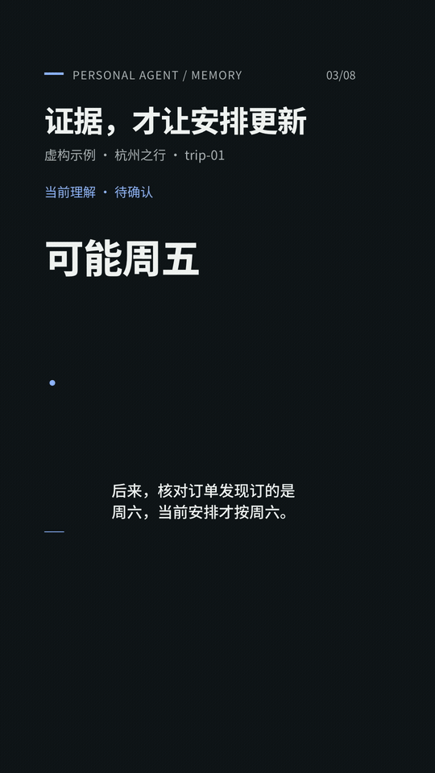

# Personal Agent Skills

给个人智能体使用的开放技能集：把可复用的工作方法写成清楚、可检查、可调整的规则。每个 Skill 独立放在 `skills/<name>/`，后续技能沿用同一结构管理。

## Layered Memory：让记忆有依据、有范围、有退出条件

你说“可能周五出发”，智能体却一直按周五安排。它记住了原话，却丢掉了“尚未确认”这个条件。

**记下来，不等于已确认；已确认，不等于永远有效；保留着，也不等于每次都要用。**

[layered-memory](skills/layered-memory/SKILL.md) 帮助智能体按照你的偏好管理记忆：

- **先筛选再记录**：排除不应记住的信息，把待确认提议、临时安排和长期偏好分开。
- **证据支持当前理解**：为同一件事保留稳定身份，区分原话、推测、当前状态与变化历史。
- **明确有效范围**：一次性要求只用于对应事项；临时信息到期停用；经过验证的方法才提炼为 Skill。
- **按需加载**：先从索引找到相关事项，再读取当前摘要，必要时追溯原文与时间线。
- **纠错与撤回追踪派生内容**：更新受影响的摘要、索引和方法，说明实际清理范围。

## 使用

下载 [layered-memory-skill.zip](https://github.com/SunnySunnyOMG/personal-agent-skills/releases/download/v0.1.0/layered-memory-skill.zip)，或复制本仓库的 `skills/layered-memory/` 文件夹到你所用智能体支持的技能目录。也可以让智能体先读取该文件夹的 `SKILL.md`。具体安装位置、技能发现和调用方式，以所用 Agent / Harness 的说明为准。

例如，给智能体这样的任务：

> 请使用 layered-memory 管理我指定的记忆目录。先检查已有结构与个人规则，再给出最小调整。我希望长期保留明确决定和稳定偏好；一次性安排只在对应事项内使用；不把猜测当成事实。操作前说明实际可读写的范围。

本 Skill 提供方法与模板。它不会自动开启采集、定时整理、到期清理或外部系统删除；这些取决于宿主工具、权限与实际接入。没有持久化工具时，智能体应交付可采用的方案，并说明尚未写入。

已完成技能格式校验，并在隔离的虚构文件库中核验过撤回派生内容、保留独立证据、处理较新无依据推测，以及一次性请求不改变长期偏好。[行为场景](skills/layered-memory/references/scenarios.md) 可用于验证自己的接入；这些检查不代表每种模型与宿主都能自动执行同样的操作。

## 阅读与图解

- [方法介绍：你的 Agent 为什么不好用？先看看它怎么记忆](docs/memory/article.zh-CN.md)
- [旅行案例图解与 GIF](docs/memory/visual-guide.zh-CN.md)
- [下载 Skill 与图解素材](https://github.com/SunnySunnyOMG/personal-agent-skills/releases/tag/v0.1.0)

所有示例均为虚构或通用说明，不包含个人记忆库和原始对话。本仓库公开 Skill、说明文档与展示图片/GIF；视频制作与剪辑工程不在公开范围内。

## 贡献

新增技能请放在独立文件夹，说明触发条件和操作范围。保持主文件简短，按需链接参考材料；用现实场景验证行为，避免把一次成功固化成通用规则。请勿提交真实个人记忆、凭证、私人数据或内容制作工程。

Reusable, portable skills for personal agents. Start with `layered-memory` for evidence-backed, user-configurable memory management.

## License

本仓库的 Skill、说明文字与展示配图采用 [MIT](LICENSE)。
