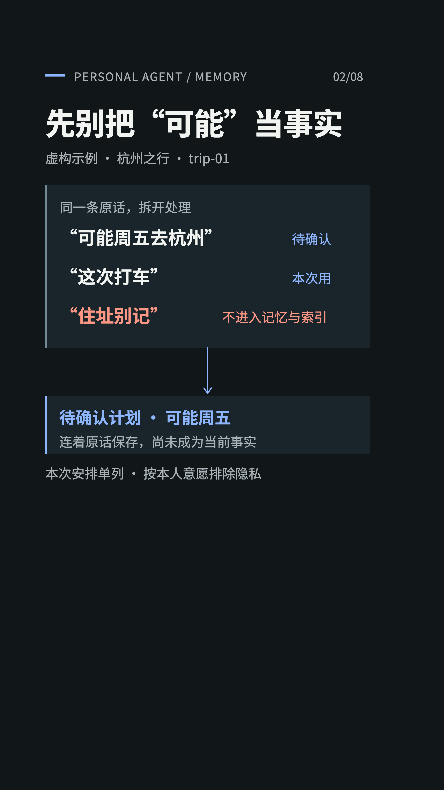
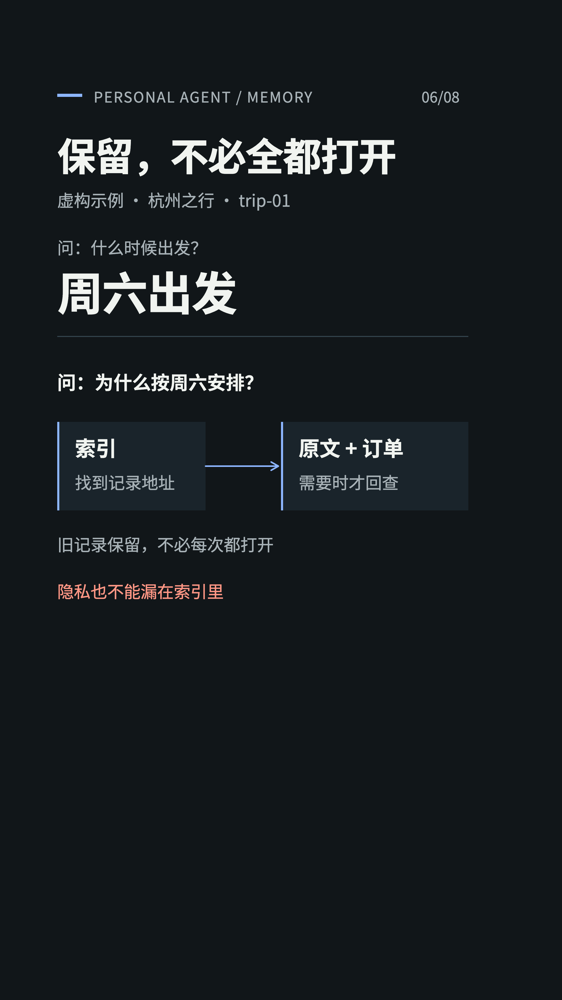
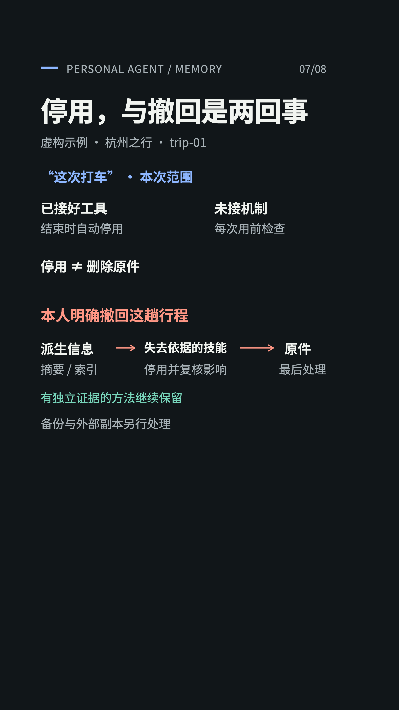

# 一趟旅行，看懂记忆怎样形成、使用和退出

这些图解配合 [layered-memory Skill](../../skills/layered-memory/SKILL.md) 使用。案例均为虚构，展示的是可以按个人偏好调整的方法。

## 先理解问题

智能体记住了“可能周五出发”，不代表周五已经确定。每条记忆都需要保留证据、适用范围和退出条件。

## 1. 先筛选，再进入记忆

不应保留的信息排除；“可能周五”保持待确认；“这次打车”只用于本次行程。

## 2. 当前判断要有证据

订单支持的是周六的预订安排，不是已经出发。先前提议仍能解释判断如何形成；新时间戳和重复总结不能替代新证据。

[查看静态图](../../assets/layered-memory/diagrams/03-evidence.png)

## 3. 不同信息有不同寿命

“这次打车”在旅行结束后停止生效；明确的长期偏好才跨任务使用。实际自动停用需要宿主接好执行机制。

## 4. 经验经过验证，才成为方法

多次独立经历支持的方法可以提炼成 Skill，保留触发条件与适用边界，避免把一次选择变成永久规则。

## 5. 用多少，读多少

问出发时间先读当前安排；问为什么，才沿索引追溯订单与原话。保留不等于每次加载，索引也要遵循隐私规则。

## 6. 停用、纠错和撤回分别处理

到期停用不等于删除。普通纠错更新现状并复核派生影响；明确撤回需要沿来源链清理可控范围。独立证据仍支持的方法可以保留，外部副本和备份另行说明。

## 7. 由你设定记忆规则

内容、适用范围、加载方式是独立维度。层次不是每条信息必须逐级晋升的阶梯，而是帮助智能体决定何时可以相信、何时可以使用、何时应该退出。

